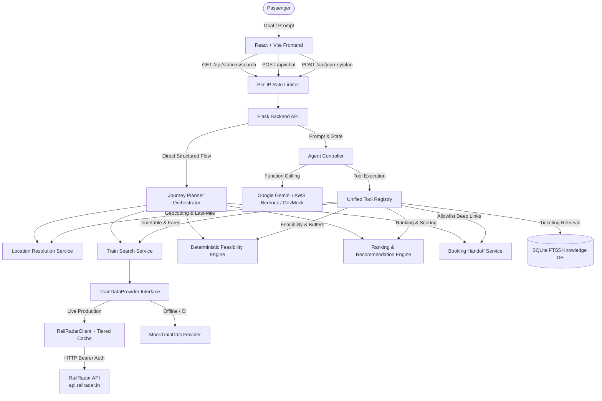

# ARCHITECTURE — RailSathi AI

> Last updated: 2026-10-10

## System Overview

RailSathi AI is a tool-using GenAI application designed with a strict architectural separation:
1. **LLM Layer**: Interprets passenger natural language goals, extracts intent, and formulates evidence-grounded explanations (Google Gemini 2.0 / AWS Bedrock Converse / DevMock).
2. **Deterministic Python Layer**: Authoritatively validates constraints, calculates latest acceptable station arrivals, executes geocoding & last-mile transit estimates, filters timetables, ranks candidates, and controls tool execution.
3. **Train & Fare Data Layer (RailRadar Integration)**: Abstracted behind `TrainDataProvider` interface, fetching live timetables (`/v1/trains/between/{from}/{to}`) and journey-specific fares (`/v1/trains/{number}/fare`) from `https://api.railradar.in`, backed by tiered in-memory caching and bounded candidate enrichment.
4. **Security & Rate Limiting Layer**: Enforces per-IP sliding window rate limits, universal CORS policies, and URL allowlist validation.
5. **Verified Knowledge Layer**: Official IRCTC policies, NTES station registries, and booking allowlists.

## Component Architecture

### 1. Frontend Layer (`Ticketing_Guidance_Module/frontend/`)
- **Technology**: React 18, Vite, Vanilla CSS design system.
- **Dual Mode Views**:
  - **Goal Journey Planner**: Conversational & structured goal input, destination station resolution, hero card for Best Feasible Match with timeline visualizer, overnight indicators (`+1d`), quota and fare source attribution, Feasible Alternatives comparison, Infeasible Options with breach badges, and verified IRCTC booking handoff buttons.
  - **Ticketing Guidance**: Interactive chat, topic discovery, source attribution chips, and execution trace logs.

### 2. Backend REST API Layer (`Ticketing_Guidance_Module/backend/app.py`)
- **Endpoints**:
  - `POST /api/journey/plan`: Natural language prompt or structured parameters → structured JourneyPlanResponse with bounded live fare enrichment.
  - `POST /api/journey/refine`: Re-evaluates plan with adjusted buffers, times, or classes.
  - `GET /api/journey/options/<request_id>`: Retrieves cached journey evaluation.
  - `GET /api/stations/search`: Debounced railway station autocomplete lookup.
  - `POST /api/chat`: AI ticketing guidance chat with agent controller.
  - `GET /api/health`: Health status, active provider, model info, and registered tools list.
  - `GET /api/sources`: Authoritative source repository metadata.

### 3. RailRadar Integration & Timetable Core (`Ticketing_Guidance_Module/backend/journey/`)
- **RailRadarClient (`railradar_client.py`)**:
  - Endpoint mappings: `/v1/trains/between/{from}/{to}`, `/v1/lookup/search/stations`, `/v1/trains/{number}/fare`.
  - Authentication: `Authorization: Bearer <RAILRADAR_API_KEY>`.
  - Resiliency: Bounded retries (default 1 retry) for 502/503/504 and network drops; never retries 400/401/404/429.
  - Caching: Thread-safe `RailRadarCache` with independent TTLs (24h stations, 1h schedules, 30m fares).
  - Safety: Secret-redacted logging and error reporting.
- **TrainDataProvider (`timetable.py`)**:
  - `RailRadarTrainDataProvider`: Normalizes responses into typed `TrainService`, `FareQuote`, and `FareBreakdown` models.
  - `MockTrainDataProvider`: High-fidelity offline data provider for testing.
  - `TrainSearchService`: Orchestrates multi-station pair searches, deduplication, and Step 4.5 candidate fare enrichment (capped by `RAILRADAR_MAX_FARE_LOOKUPS_PER_REQUEST = 5`).

### 4. Goal Journey Planning Core (`Ticketing_Guidance_Module/backend/journey/`)
- **Data Models (`models.py`)**: Strict Pydantic models (`TripRequirements`, `StationCandidate`, `TrainService`, `FareQuote`, `FareBreakdown`, `JourneyEvaluation`, `BookingHandoff`, `JourneyPlanResponse`).
- **Location Resolution (`location.py`)**: Resolves venues and cities to coordinates, maps nearby departure/arrival railway hubs, and computes deterministic last-mile transfer times.
- **Feasibility Engine (`feasibility.py`)**:
  - Formula: `latest_acceptable_station_arrival = meeting_start - requested_buffer - estimated_last_mile_duration`
  - Correct date shifting for overnight journeys (`day_offset = 1` or `2`).
  - Strict hard constraint evaluation (arrival deadline, buffer satisfaction, budget ceiling).
- **Ranking Engine (`ranking.py`)**: Deterministic scoring prioritizing deadline safety, preferred train matches (+35), class matches (+20), duration, and budget.
- **Booking Handoff (`booking.py`)**: Safe deep link generation strictly validated against approved hosts (`irctc.co.in`, `enquiry.indianrail.gov.in`, `confirmtkt.com`).
