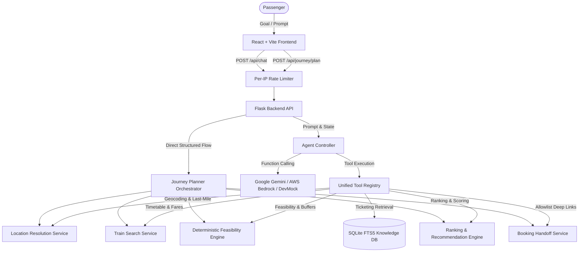

# ARCHITECTURE — RailSathi AI

> Last updated: 2026-10-10

## System Overview

RailSathi AI is a tool-using GenAI application designed with a strict architectural separation:
1. **LLM Layer**: Interprets passenger natural language goals, extracts intent, and formulates evidence-grounded explanations (Google Gemini 2.0 / AWS Bedrock Converse / DevMock).
2. **Deterministic Python Layer**: Authoritatively validates constraints, calculates latest acceptable station arrivals, executes geocoding & last-mile transit estimates, filters timetables, ranks candidates, and controls tool execution.
3. **Security & Rate Limiting Layer**: Enforces per-IP sliding window rate limits, universal CORS policies, and URL allowlist validation.
4. **Verified Knowledge & Timetable Data Layer**: Official IRCTC policies, NTES train schedules, station registries, and booking allowlists.

## Component Architecture

### 1. Frontend Layer (`Ticketing_Guidance_Module/frontend/`)
- **Technology**: React 18, Vite, Vanilla CSS design system.
- **Dual Mode Views**:
  - **Goal Journey Planner**: Conversational & structured goal input, quick scenario templates, destination station resolution, hero card for Best Feasible Match with timeline step visualizer, Feasible Alternatives comparison, Infeasible Options with constraint breach badges, one-click quick refiners, and verified IRCTC booking handoff buttons.
  - **Ticketing Guidance**: Interactive chat, topic discovery, source attribution chips, and execution trace logs.

### 2. Backend REST API Layer (`Ticketing_Guidance_Module/backend/app.py`)
- **Endpoints**:
  - `POST /api/journey/plan`: Natural language prompt or structured parameters → structured JourneyPlanResponse.
  - `POST /api/journey/refine`: Re-evaluates plan with adjusted buffers, times, or classes.
  - `GET /api/journey/options/<request_id>`: Retrieves cached journey evaluation.
  - `POST /api/chat`: AI ticketing guidance chat with agent controller.
  - `GET /api/health`: Health status, model info, and registered tools list.
  - `GET /api/sources`: Authoritative source repository metadata.
- **Security & Serving**: In-memory sliding-window IP rate limiting (`backend/rate_limiter.py`), CORS headers, and static production build serving.

### 3. Goal Journey Planning Core (`Ticketing_Guidance_Module/backend/journey/`)
- **Data Models (`models.py`)**: Strict Pydantic models (`TripRequirements`, `ResolvedLocation`, `StationCandidate`, `LastMileEstimate`, `TrainService`, `JourneyEvaluation`, `BookingHandoff`, `JourneyPlanResponse`).
- **Location Resolution (`location.py`)**: Resolves venues and cities to coordinates, maps nearby departure/arrival railway hubs (MAS, MS, SBC, YPR, SMVB, NDLS, CSMT, BCT, etc.), and computes deterministic last-mile transfer times.
- **Timetable Search (`timetable.py`)**: Authoritative Indian Railways schedules, stops, run days, class allocations, and fare structures.
- **Feasibility Engine (`feasibility.py`)**:
  - Formula: `latest_acceptable_station_arrival = meeting_start - requested_buffer - estimated_last_mile_duration`
  - Correct date shifting for overnight journeys (`day_offset = 1` or `2`).
  - Strict hard constraint evaluation (arrival deadline, buffer satisfaction, budget ceiling).
- **Ranking Engine (`ranking.py`)**: Deterministic scoring prioritizing deadline safety, preferred train matches (+35), class matches (+20), duration, and budget.
- **Booking Handoff (`booking.py`)**: Safe deep link generation strictly validated against approved hosts (`irctc.co.in`, `enquiry.indianrail.gov.in`, `confirmtkt.com`).

### 4. Agent Controller & Tool Registry (`Ticketing_Guidance_Module/backend/agent/` & `backend/tools/`)
- **Controller**: Enforces tool-call limits (`MAX_TOOL_CALLS = 6`), round limits (`MAX_AGENT_ROUNDS = 4`), schema argument validation, and full execution tracing (`trace_id`).
- **LLM Integrations**:
  - `backend/agent/llm.py`: Google GenAI Gemini 2.0 SDK client.
  - `backend/agent/bedrock.py`: AWS Bedrock Converse provider with streaming and function tool calling.
  - `backend/agent/mock_llm.py`: High-fidelity deterministic dev mock client.
- **Unified Tool Registry (13 Tools)**:
  - `parse_trip_requirements`
  - `resolve_location`
  - `find_nearby_stations`
  - `estimate_last_mile`
  - `search_trains`
  - `get_train_details`
  - `evaluate_journey_feasibility`
  - `plan_goal_based_journey`
  - `search_ticketing_guidance`
  - `explain_ticket_class`
  - `explain_reservation_status`
  - `get_booking_steps`
  - `get_cancellation_refund_guidance`
