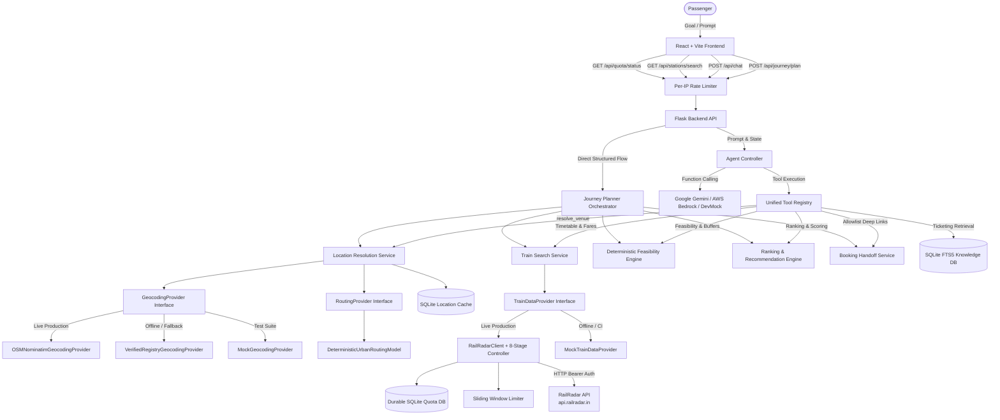

# ARCHITECTURE — RailSathi AI

> Last updated: 2026-10-10

## System Overview

RailSathi AI is a tool-using GenAI application designed with a strict architectural separation:
1. **LLM Layer**: Interprets passenger natural language goals, extracts intent, and formulates evidence-grounded explanations (Google Gemini 2.0 / AWS Bedrock Converse / DevMock). LLMs are never used to guess or invent geographical coordinates.
2. **Deterministic Python Layer**: Authoritatively validates constraints, calculates latest acceptable station arrivals, executes geocoding & last-mile transit estimates, filters timetables, ranks candidates, and controls tool execution.
3. **Geocoding & Spatial Routing Layer**: Abstracted via `GeocodingProvider` and `RoutingProvider` protocols. Supports live OpenStreetMap Nominatim with rate limiting & custom User-Agent, local verified datasets, and deterministic urban traffic models ($1.30\times$ Haversine detour, 22 km/h base speed, 8m buffer). Operates with 100% architectural isolation from RailRadar API quotas.
4. **Train & Fare Data Layer (RailRadar Integration)**: Abstracted behind `TrainDataProvider` interface, fetching live timetables (`/v1/trains/between/{from}/{to}`) and journey-specific fares (`/v1/trains/{number}/fare`) from `https://api.railradar.in`, backed by SQLite-persisted monthly quota enforcement (100 cap, 5 reserve), sliding-window rate limiting (10 RPM), and bounded candidate fare enrichment (top-3).
5. **Security & Rate Limiting Layer**: Enforces per-IP sliding window rate limits, universal CORS policies, and URL allowlist validation.
6. **Verified Knowledge Layer**: Official IRCTC policies, NTES station registries, and booking allowlists.

## Component Architecture

### 1. Frontend Layer (`Ticketing_Guidance_Module/frontend/`)
- **Technology**: React 18, Vite, Vanilla CSS design system.
- **Dual Mode Views**:
  - **Goal Journey Planner**: Conversational & structured goal input, dynamic venue resolution, interactive suggested location chips for multi-branch ambiguity, departure/arrival hub display, hero card for Best Feasible Match with timeline visualizer, overnight indicators (`+1d`), quota and fare source attribution, Connecting Journeys multi-leg transfer visualizer, Feasible Alternatives comparison, Infeasible Options with breach badges, and verified IRCTC booking handoff buttons.
  - **Ticketing Guidance**: Interactive chat, topic discovery, source attribution chips, and execution trace logs.

### 2. Backend REST API Layer (`Ticketing_Guidance_Module/backend/app.py`)
- **Endpoints**:
  - `POST /api/journey/plan`: Natural language prompt or structured parameters → structured `JourneyPlanResponse` with dynamic geocoding, bounded fare enrichment, and connecting train discovery.
  - `POST /api/journey/refine`: Re-evaluates plan with adjusted buffers, times, or classes.
  - `GET /api/journey/options/<request_id>`: Retrieves cached journey evaluation.
  - `GET /api/stations/search`: Debounced railway station autocomplete lookup.
  - `GET /api/quota/status`: Real-time durable RailRadar monthly quota and rate-limit diagnostics.
  - `POST /api/chat`: AI ticketing guidance chat with agent controller.
  - `GET /api/health`: Health status, active provider, model info, and registered tools list.
  - `GET /api/sources`: Authoritative source repository metadata.

### 3. Geocoding & Spatial Routing Core (`Ticketing_Guidance_Module/backend/journey/`)
- **Geocoding Providers (`geocoding.py`)**:
  - `OSMNominatimGeocodingProvider`: Live OpenStreetMap Nominatim adapter complying with OSM Usage Policies ($\ge 1.0$s interval lock, custom User-Agent `RailSathi-AI/1.0`, timeout and connection drop recovery).
  - `VerifiedRegistryGeocodingProvider`: Offline verified local dataset provider.
  - `MockGeocodingProvider`: Fixture injection provider for offline tests.
- **Routing Providers (`routing.py`)**:
  - `DeterministicUrbanRoutingModel`: Detour ratio of $1.30\times$ Haversine distance, 22 km/h average urban cab speed, 8m dispatch/station buffer, explicitly labeled `is_heuristic=True`.
  - `MockRoutingProvider`: Injected mock for provider-derived routes (`is_heuristic=False`).
- **Location Resolution Service (`location.py`)**:
  - Stages A–E (intent normalization $\rightarrow$ persistent SQLite cache $\rightarrow$ station lookup $\rightarrow$ dynamic geocoding $\rightarrow$ coordinate & locality validation $\rightarrow$ multi-branch ambiguity handling with clarification chips $\rightarrow$ SQLite caching).
  - Unverified locations return `latitude=None, longitude=None, confidence=0.0` (never substitutes city centroids).
  - Unknown last-mile duration remains `None` (never substituted with zero).

### 4. RailRadar Integration & Timetable Core (`Ticketing_Guidance_Module/backend/journey/`)
- **RailRadarClient (`railradar_client.py`)**:
  - Endpoint mappings: `/v1/trains/between/{from}/{to}`, `/v1/lookup/search/stations`, `/v1/trains/{number}/fare`.
  - Authentication: `Authorization: Bearer <RAILRADAR_API_KEY>`.
  - Monthly Quota: `DurableRailRadarQuotaManager` with SQLite persistence across restarts (100 hard cap, 5 reserve), atomic reservation, conservative attempt accounting, and dashboard reconciliation.
  - Sliding-Window Rate Limiter: `RailRadarPerMinuteLimiter` (10 RPM default) with `Retry-After` header tracking and jittered exponential backoff.
  - Centralized 8-Stage Execution Controller: Validation $\rightarrow$ Cache $\rightarrow$ SingleFlight deduplication $\rightarrow$ Quota check $\rightarrow$ RPM limiter $\rightarrow$ Pre-dispatch recheck $\rightarrow$ Atomic attempt record $\rightarrow$ Dispatch $\rightarrow$ Outcome logging.
  - Cost Optimization: Top-3 candidate fare enrichment and suburban stop pair pruning.

### 5. Goal Journey Planning Core (`Ticketing_Guidance_Module/backend/journey/`)
- **Data Models (`models.py`)**: Strict Pydantic models (`TripRequirements`, `GeocodedPlaceCandidate`, `ResolvedLocation`, `StationCandidate`, `LastMileEstimate`, `TrainService`, `FareQuote`, `ConnectingJourneyLeg`, `JourneyEvaluation`, `BookingHandoff`, `JourneyPlanResponse`).
- **Connecting Train Discovery (`connecting.py`)**: Multi-leg journey planning across corridor hubs with layover validation (30m to 6h) and dual-leg IRCTC booking links.
- **Feasibility Engine (`feasibility.py`)**:
  - Formula: `latest_acceptable_station_arrival = meeting_start - requested_buffer - estimated_last_mile_duration`
  - Correct date shifting for overnight journeys (`day_offset = 1` or `2`).
  - Indeterminate safety: Missing or uncertain last-mile transit duration cannot produce a false feasible journey (`match_category='insufficient_data'`).
- **Ranking Engine (`ranking.py`)**: Deterministic scoring prioritizing deadline safety, preferred train matches (+35), class matches (+20), duration, and budget.
- **Booking Handoff (`booking.py`)**: Safe deep link generation strictly validated against approved hosts (`irctc.co.in`, `enquiry.indianrail.gov.in`, `confirmtkt.com`).
