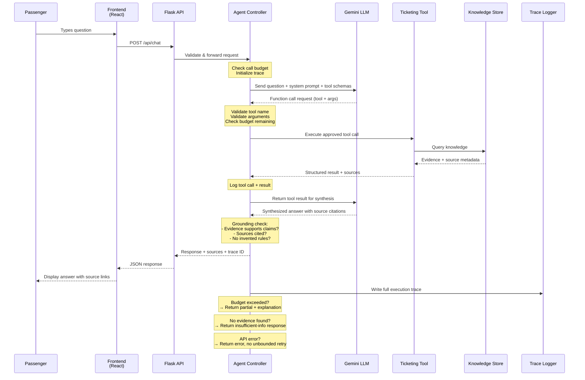
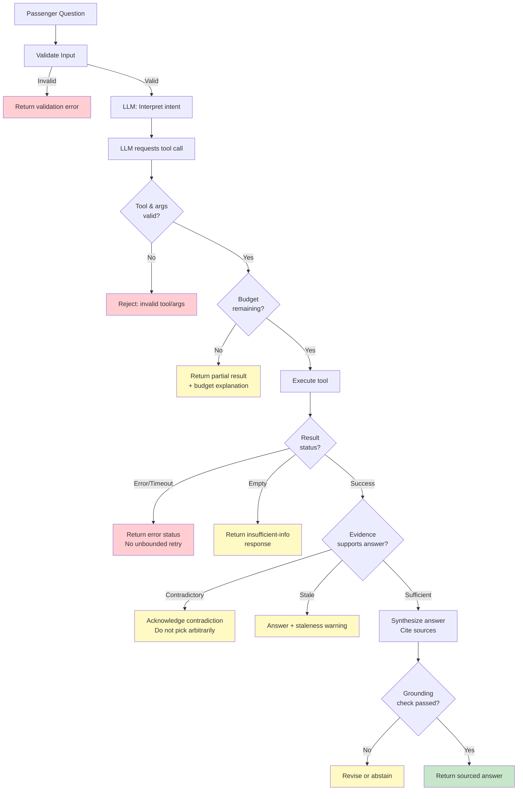
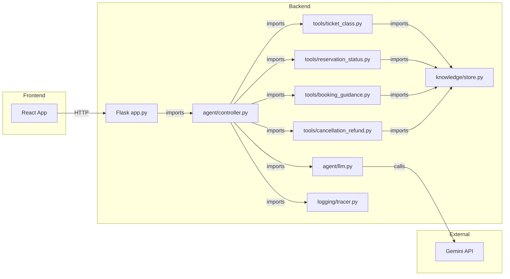

# DATA FLOW — RailSathi AI

> Last updated: 2026-10-10
> All stages are **PLANNED** — no application code implemented yet.

## Request Lifecycle

## Error & Abstention Flows

## Dependency Diagram

